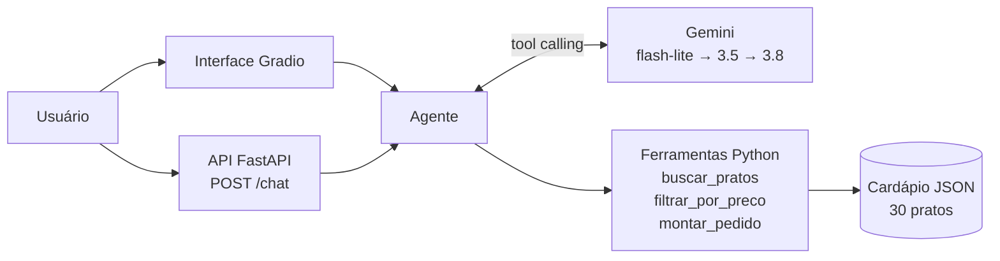

# 🛵 Agente de Pedidos com LLM

Assistente de delivery que entende pedidos em linguagem natural ("algo vegano e sem glúten até R$ 35",
"quero 2 smash e uma batata") e usa **tool calling** para buscar pratos, filtrar por preço e montar o
pedido num cardápio. O modelo não inventa pratos nem preços: ele decide qual ferramenta chamar, o código
Python executa e o modelo responde com base no resultado.

<!--  -->

**Avaliação:** 15 de 15 casos (100%) com `gemini-3.1-flash-lite`, em duas rodadas seguidas, tempo médio
de 8 s por caso. [Detalhes abaixo](#avaliação).

## Como funciona



O agente roda o ciclo de tool calling explicitamente ([app/agente.py](app/agente.py)), em vez do modo
automático do SDK, para registrar cada chamada (usado na interface e na avaliação):

1. Envia ao Gemini o histórico da conversa, as instruções e a descrição das ferramentas (gerada das
   docstrings).
2. Se o modelo pede uma ferramenta, o código a executa e devolve o resultado.
3. Repete até o modelo responder com texto, com limite de 5 voltas.

### Decisões de engenharia

- **Ferramentas que não quebram.** Argumentos inválidos vindos do modelo viram `{"erro": ...}` em vez de
  exceção, e o modelo corrige na volta seguinte.
- **Fallback entre modelos.** Em 5xx, timeout ou cota esgotada (429), o agente passa para o próximo modelo.
  A cota do Gemini é por modelo, então um 429 no principal não impede o reserva.
- **Circuit breaker.** Um modelo sem cota fica pausado por 10 min, e um instável por 1 min, compartilhado
  entre sessões, para não gastar tempo em cada mensagem tentando um modelo que já se sabe fora.
- **Retentativas limitadas.** O SDK insistia por minutos num modelo sobrecarregado. O limite é de 2
  tentativas e 20 s por chamada, e 429 não é repetido.
- **Modelo escolhido pela avaliação.** O `flash-lite` acertou todos os casos, foi o mais rápido e tem a
  maior cota grátis, por isso é o principal.

## Stack

Python 3.12 · Gemini API (`google-genai`, tool calling) · FastAPI · Gradio · pytest · Docker

## Como rodar

Você precisa de uma chave gratuita da [Gemini API](https://aistudio.google.com/api-keys).

### Local

```bash
git clone git@github.com:LucasSufredini/agente-pedidos.git && cd agente-pedidos
python3 -m venv .venv && source .venv/bin/activate
pip install -r requirements-dev.txt
cp .env.example .env    # coloque sua chave em GEMINI_API_KEY
```

```bash
uvicorn app.servidor:app --port 7860   # interface em http://localhost:7860, API em /docs
python -m app.agente                   # chat no terminal
pytest                                 # 60 testes, sem chamar a API
python -m app.avaliacao                # avaliação (usa a API)
```

### Docker

```bash
docker build -t agente-pedidos .
docker run --rm --env-file .env -p 7860:7860 agente-pedidos
```

A imagem roda sem root, tem healthcheck em `/health` e não inclui o `.env`. A chave entra só na execução.

### API

```bash
curl -X POST localhost:7860/chat -H 'Content-Type: application/json' \
  -d '{"mensagem": "Tem comida japonesa até 30 reais?"}'
```

A resposta traz `sessao_id`, que deve ser enviado nas próximas mensagens para o agente lembrar da conversa,
além da resposta, das ferramentas chamadas e do modelo usado.

## Avaliação

[data/avaliacao.json](data/avaliacao.json) tem 15 casos com critérios objetivos, sem LLM como juiz:

- **menciona / não menciona:** a resposta cita os pratos certos e nenhum errado;
- **pedido:** o último `montar_pedido` tem exatamente os ids e quantidades esperados;
- **não chama:** por exemplo, não montar pedido quando o prato não existe.

Os casos cobrem restrições combinadas, faixa de preço, quantidade por extenso, conversa de várias
mensagens, itens de restaurantes diferentes, prato inexistente, preço impossível e pergunta fora do assunto.

```bash
python -m app.avaliacao --modelo gemini-3.1-flash-lite   # um modelo, sem fallback
```

| Modelo | Acertos | Tempo médio |
|---|---|---|
| `gemini-3.1-flash-lite` | 15/15 (100%), em duas rodadas | 8,1 s |

Falhas do provedor (503, 504, 429) são repetidas e, se persistirem, o caso fica fora da conta e é
reportado à parte. Instabilidade do Google não mede a qualidade do agente.

**O que a avaliação encontrou:**

- **Bug na ferramenta.** Para "três açaís" o modelo chamou `montar_pedido(ids=[28, 28, 28])`, e o
  pedido saía como três linhas de "1x". A ferramenta passou a agrupar ids repetidos.
- **Bug no próprio avaliador.** Pelo mesmo motivo, ele marcava como erro um caso que o agente acertou.
  Agora o avaliador também tem testes.
- **Prompt.** O agente pedia confirmação antes de montar o pedido. As instruções passaram a deixar claro
  que `montar_pedido` só monta um resumo.

**Limitações:** 15 casos é uma amostra pequena e o cardápio é fictício. O resultado mostra que o fluxo
funciona, não que o agente nunca erra. A comparação com outros modelos ficou pendente, porque a cota
grátis do `3.8-flash` (20 requisições por dia) não cobre uma rodada completa.

## Estrutura

```
app/
  ferramentas.py   buscar_pratos, filtrar_por_preco, montar_pedido
  agente.py        ciclo de tool calling, fallback, circuit breaker
  main.py          API FastAPI (POST /chat, sessões)
  interface.py     interface Gradio
  servidor.py      API + interface num único servidor
  avaliacao.py     roda os casos e mede o acerto
data/              cardápio e casos de avaliação
tests/             60 testes (ferramentas, agente, API, avaliador)
resultados/        saída das avaliações
```

## Próximos passos

- Sessões em Redis em vez de memória, para escalar com mais de uma instância.
- RAG com avaliações reais de clientes para recomendar pratos.
- Mais casos de avaliação, incluindo pedidos ambíguos e erros de digitação, e comparação entre modelos.
- Métricas de produção: latência por modelo, taxa de fallback e custo por conversa.
